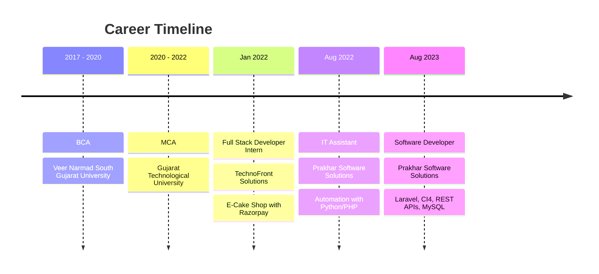

<!-- ⚠️ Ctrl+F → GITHUB_USERNAME ko apne asli GitHub username se Replace All karein -->

  

 

 

> ### 👋 Hello, I'm Moulik
> A **Laravel PHP Developer** from **Nani Daman, India** with **4 years** of experience building, maintaining and optimizing web applications. I care about clean MVC architecture, fast MySQL queries, secure code and reliable third-party integrations.
>
> 🟢 **Open to work** · ⚡ **Immediate joiner** · 🌍 **Remote / open to relocation**

 

## 📌 Quick Facts

<table>
<tr>
<td align="center" width="25%">
<h2>4+</h2>
Years Experience
</td>
<td align="center" width="25%">
<h2>10+</h2>
Projects Delivered
</td>
<td align="center" width="25%">
<h2>50%</h2>
Traffic Growth on Live Gov Platform
</td>
<td align="center" width="25%">
<h2>8.34</h2>
MCA GPA
</td>
</tr>
</table>

 

## 🧰 What I Work With

<b>🔎 See the full skills breakdown</b>

 

| Area | Details |
|---|---|
| ⚙️ **Backend** | PHP 7.4/8.x, Laravel, CodeIgniter 4, Core PHP, OOP, MVC |
| 🗄️ **Database** | MySQL schema design, query optimization, indexing, MongoDB (basic) |
| 🎨 **Frontend** | JavaScript, jQuery, Ajax, HTML5, CSS3, Bootstrap |
| 🔌 **Integrations** | REST APIs, Razorpay, SMS APIs, government service APIs |
| 🛡️ **Security** | SQL injection prevention, XSS and CSRF protection |
| 🧪 **Tools** | Git, GitHub, Postman, Composer, phpMyAdmin, cPanel, SSH, Agile/Scrum |
| 🤖 **AI-assisted dev** | ChatGPT and Claude for code generation, review and troubleshooting |

 

## 🛣️ My Journey

 

## 🚀 Projects

### 🏛️ Government & Enterprise

| Project | What it does | Stack |
|---|---|---|
| **Labourdnhdd** | Government labour platform with REST APIs, MySQL optimization and caching (**+50% traffic**) | `Laravel` `CI4` `MySQL` |
| **NCS DNH&DD** | Job-seeker portal with third-party API integration and dynamic frontend | `PHP` `MySQL` `REST` |
| **Employment Exchange** | Job matching with employer and applicant modules, search and filters | `PHP` `MySQL` `Ajax` |
| **Annual Return** | Compliance tracker with dynamic forms and automated reports | `PHP` `MySQL` `JS` |
| **Shipwave** | Business management system with multi-role access | `PHP` `MySQL` `jQuery` |

<b>🎮 More projects</b>

 

| Project | What it does | Stack |
|---|---|---|
| **E-Cake Shop** | E-commerce store with end-to-end Razorpay payments | `PHP` `jQuery` `Razorpay` |
| **BGYT Esports** | Esports web platform | `PHP` `MySQL` |
| **Anime Watch** | Anime browsing and watching site | `PHP` `JS` |
| **Daman Movie Hub** | Movie listing and info portal | `PHP` `MySQL` |
| **BOCW Board** | Board management web application | `PHP` `MySQL` |

 

## 📊 GitHub Stats

 

 

## 📫 Get In Touch

  

**Hiring for a Laravel / PHP backend role? Let's talk.**

