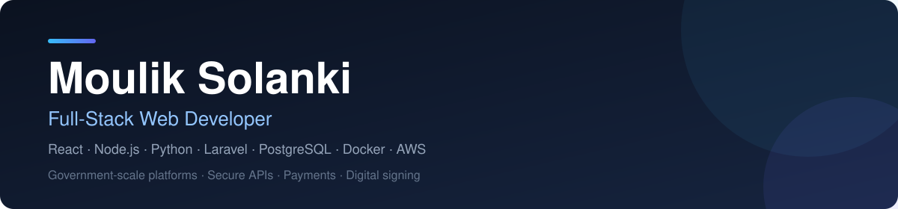

 

## About

Full-Stack Web Developer from Daman, India, with **4 years of experience** (3+ years at Prakhar Software Solutions). I build government-scale web platforms: compliance portals, SSO bridges, payment integrations and mobile app backends. Immediate joiner, open to remote work and relocation.

|  |  |
| :-- | :-- |
| **Focus** | REST APIs, secure workflows, dashboards, database design |
| **Security** | RBAC, HMAC-SHA256 token auth, PKI / DSC digital signing, encryption |
| **Performance** | Redis-cached filtering that cut external API latency by 40% |
| **AI** | Daily use of AI coding tools; LLM and RAG-based API integrations |
| **Availability** | Immediate, remote or relocation |

## Tech Stack

**Frontend**&nbsp;      

**Backend**&nbsp;     

**Data**&nbsp;     

**DevOps & Tools**&nbsp;      

## Selected Work

<b>Digital Labour Compliance & Automation Portal</b> · <a href="https://labourdnhdd.in">labourdnhdd.in</a>

 

E-governance platform that automates business registrations, licensing and compliance.

- Multi-step digital workflows from requirements to deployment, replacing manual paperwork
- SBIePay payment gateway and Cyber Treasury module for real-time statutory fees and reconciliation
- Hardware PKI DSC signing (Watchdata ProxKey) with public QR code verification

<b>NCS Gateway & Automation Bridge</b> · <a href="https://demo.labourdnhdd.in/NCS/login">demo</a>

 

Integration layer between local enterprise systems and central government databases.

- Outgoing and callback partner SSO using HMAC-SHA256 tokens
- Background data sync pipelines with a Redis-cached faceted filter, cutting API latency by 40%

<b>BOCW Digital Labour Chowk</b> · mobile app backend

 

Location-based marketplace connecting contractors with local workers.

- Node.js and MongoDB backend built for high concurrency
- SMS OTP verification and real-time GPS / Firebase location mapping

<b>BOCW & Cess Management System</b>

 

Cloud platform for construction project tracking and automated tax assessments.

- 4-step submission workflow with unified dashboards
- Multi-tenant RBAC and client-side encryption

<b>More projects</b>

 

| Project | Description | Link |
| :-- | :-- | :-: |
| Department Main Portal | Central single-window portal with a custom CMS for announcements, gazettes and tenders | [Live](https://labourdnhdd.in) |
| Employment Exchange | Job-matching platform with employer and applicant modules | [Live](https://emp.labourdnhdd.in/) |
| e-Shram Microsite | Scheme discovery and locator tools on a custom CMS | n/a |
| Shipwave | Business and logistics management system with multi-role access | [Live](https://shipwave.in) |

## GitHub

## Contact

Open to full-stack roles, remote or on-site. Email is the fastest way to reach me: **solankimoulik18@gmail.com**
