

<!-- HERO BANNER -->

  

<!-- SOCIAL & PROJECT QUICK BADGES -->


<!-- SECTION 1: ARCHITECTURE & CORE STRENGTHS -->

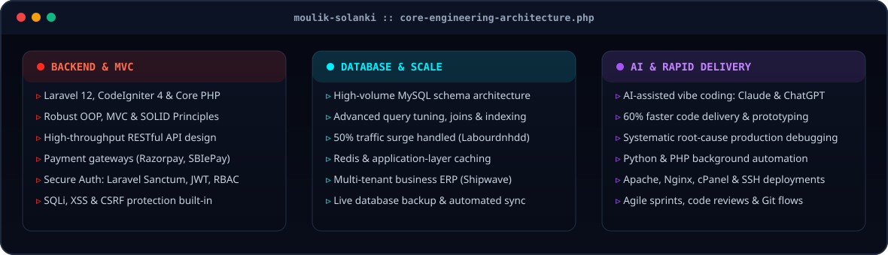

<!-- SECTION 2: TECHNICAL ARSENAL -->

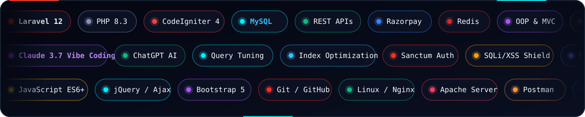

  

 

<!-- SECTION 3: FEATURED PRODUCTION WORK -->

<a href="https://labourdnhdd.in"></a>

<a href="https://emp.labourdnhdd.in/">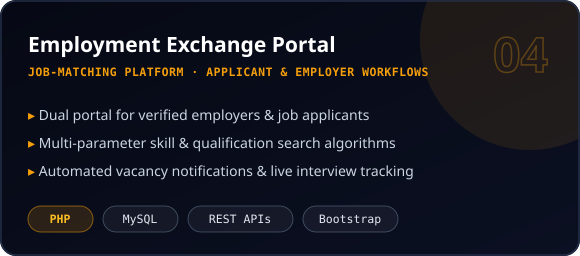</a>


  

<a href="https://shipwave.in"></a>

<!-- SECTION 4: IMPACT & METRICS -->
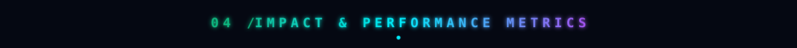

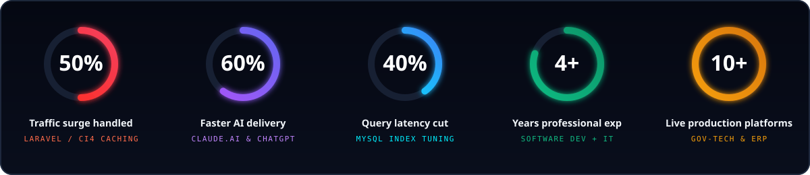

<!-- SECTION 5: GITHUB ANALYTICS -->

  

  

  

<picture>
  <source media="(prefers-color-scheme: dark)" srcset="https://raw.githubusercontent.com/Moulik2886/Moulik2886/output/github-snake-dark.svg"/>
  <source media="(prefers-color-scheme: light)" srcset="https://raw.githubusercontent.com/Moulik2886/Moulik2886/output/github-snake-dark.svg"/>
  
</picture>

  

<!-- FOOTER -->
<a href="mailto:solankimoulik18@gmail.com">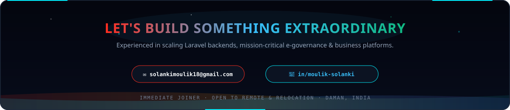</a>

